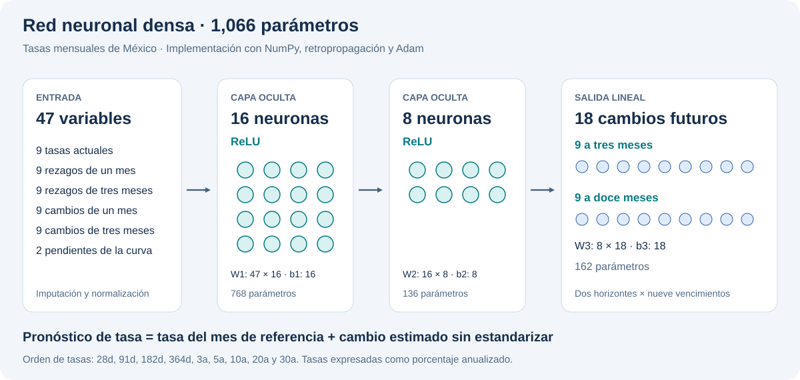
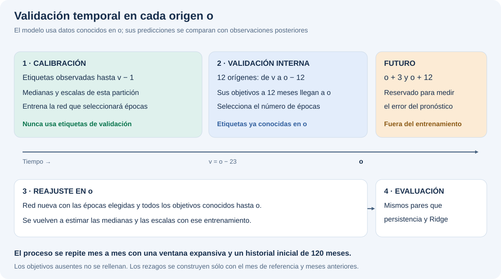

# Red neuronal para pronosticar tasas de México

Proyecto de forecasting con una red neuronal densa (MLP) programada en NumPy: propagación hacia adelante, retropropagación y optimizador Adam. Incluye el modelo entrenado, su evaluación temporal y el script para subirlo a tu cuenta de Hugging Face.

**Para Windows y VS Code:** empieza en [PUBLICACION.md](PUBLICACION.md). Incluye la comprobación visual en tu PC, el registro de entrenamiento y los comandos para GitHub y Hugging Face.



## Comprobación visual

```powershell
python scripts/verify_model.py
Start-Process .\outputs\verification_report.html
```

La comprobación verifica los tensores, reproduce los pronósticos, recalcula métricas y ejecuta las pruebas sin acceder a Internet. El informe indica el sistema donde se ejecutó y si existe un registro de entrenamiento asociado a los pesos actuales. Para volver a entrenar ejecuta `python scripts/train_neural.py` y repite la comprobación.

## 1. Probar el modelo que ya está entrenado

Requiere Python 3.11 o posterior. Descomprime el ZIP y abre una terminal dentro de `mexico-neural-hf`.

En Windows PowerShell:

```powershell
py -m venv .venv
.\.venv\Scripts\Activate.ps1
python -m pip install -r requirements.txt
python scripts/predict.py
```

En macOS o Linux, activa el entorno con `source .venv/bin/activate`.

El script imprime 18 pronósticos en JSON: nueve tasas a tres meses y nueve a doce meses. El ejemplo usa septiembre de 2026 como mes de referencia; sus meses objetivo son diciembre de 2026 y septiembre de 2027. Las tasas están en porcentaje anualizado: `7.25` representa 7.25%, no `0.0725`.

## 2. Cómo está construida la red

Arquitectura: **47 entradas → 16 neuronas ReLU → 8 neuronas ReLU → 18 salidas lineales**. Tiene **1,066 parámetros entrenables**.

| Bloque de entrada | Cantidad | Qué contiene |
| --- | ---: | --- |
| Tasas del mes de referencia | 9 | CETEs de 28, 91, 182 y 364 días; MBONOs de 3, 5, 10, 20 y 30 años |
| Rezagos de un mes | 9 | Las mismas tasas un mes antes |
| Rezagos de tres meses | 9 | Las mismas tasas tres meses antes |
| Cambios de un mes | 9 | Tasa actual menos su rezago de un mes |
| Cambios de tres meses | 9 | Tasa actual menos su rezago de tres meses |
| Pendientes de la curva | 2 | Tasa de 30 años menos 28 días y tasa de 10 años menos 3 años |

Las capas ocultas calculan `ReLU(xW + b)`. La última capa estima los cambios futuros estandarizados. La inferencia deshace esa estandarización y suma cada cambio a la tasa del mes de referencia:

```text
tasa pronosticada(t + horizonte) = tasa(t) + cambio estimado
```

Los primeros nueve resultados corresponden a tres meses; los siguientes nueve, a doce meses. El orden exacto de las entradas está en `hf_model/config.json`, campo `feature_names`.

Cada iteración de entrenamiento:

1. Calcula las salidas de la red.
2. Mide el error cuadrático sobre objetivos observados y añade regularización L2.
3. Calcula las derivadas de los pesos mediante retropropagación.
4. Actualiza esos pesos con Adam.

`src/network.py` contiene estas operaciones explícitamente. Los objetivos ausentes tienen una máscara y no contribuyen a la pérdida. Cada una de las 18 salidas tiene el mismo peso después de promediar sus observaciones.

## 3. Entrenar desde el CSV

```powershell
python scripts/train_neural.py
```

Este comando repite la evaluación histórica y exporta un modelo final con todos los objetivos conocidos hasta septiembre de 2026. Funciona en CPU y no necesita una API de IA ni una GPU.

El CSV original contiene 1,936 observaciones, distribuidas en 240 meses, de octubre de 2006 a septiembre de 2026. Hay nueve vencimientos y 224 celdas ausentes en la matriz mensual. El entrenamiento final tiene 227 filas elegibles; las 18 salidas tienen distintos números de etiquetas observadas.

La preparación sigue estas reglas:

- Las fechas se ordenan en meses de calendario. Un dato faltante de entrada se arrastra desde el pasado por un máximo de dos meses.
- Los objetivos usan exclusivamente tasas realmente observadas en el mes futuro. Nunca se rellenan objetivos.
- Los rezagos que todavía falten se imputan con medianas del entrenamiento. La normalización también se aprende únicamente con el entrenamiento.
- La evaluación avanza mes por mes desde un historial inicial de 120 meses. Cada modelo utiliza solamente los objetivos disponibles en su mes de referencia.
- El número de épocas se selecciona con una validación cronológica interna de 12 meses. Los objetivos de calibración terminan antes del inicio de esa validación; los objetivos de validación ya son conocidos en el origen evaluado.
- Se vuelve a entrenar una red nueva con el número de épocas elegido. La arquitectura y los demás hiperparámetros permanecen fijos durante el backtest.



Configuración fija: semilla 42, tasa de aprendizaje 0.003, L2 0.01, máximo 200 épocas y paciencia de 20 épocas. El modelo final seleccionó 44 épocas. Las curvas de pérdida están en `outputs/`.

### Resultado observado

RMSE en puntos base; menor es mejor. Un punto porcentual equivale a 100 puntos base.

| Horizonte | Red neuronal | Persistencia | Ridge con nueve tasas | Pares evaluados |
| --- | ---: | ---: | ---: | ---: |
| 3 meses | 62.21 | 66.07 | 56.50 | 965 |
| 12 meses | 197.82 | 187.28 | 174.58 | 891 |

La red reduce el RMSE frente a persistencia aproximadamente 5.85% a tres meses; a doce meses lo aumenta aproximadamente 5.63%. Ridge obtiene menor error en ambos horizontes. Esta comparación usa los mismos pares de origen, mes objetivo y vencimiento. Los resultados completos, incluyendo otros modelos, están en `outputs/comparison.csv`.

Estos datos mensuales son pocos para una red neuronal. El resultado demuestra una implementación entrenable y una evaluación reproducible; su uso como modelo de mayor precisión requiere evidencia adicional. Los objetivos de horizontes consecutivos se solapan, por lo que los pares evaluados no son observaciones independientes. No se han estimado intervalos de predicción.

## 4. Subir el modelo a Hugging Face

Inicia sesión desde tu terminal. Puedes utilizar el acceso que ofrezca el CLI o un token de Hugging Face con permiso de escritura en tu cuenta:

```powershell
hf auth login
python scripts/upload_hf.py --dry-run
python scripts/upload_hf.py --name mexico-yield-neural
```

El último comando crea `TU_USUARIO/mexico-yield-neural` como repositorio de modelos **privado**. Si ese repositorio ya existe y es privado, añade una versión. Si ya existe como público, pide utilizar otro nombre. La ejecución real necesita conexión a Internet y permisos para crear o actualizar el repositorio.

Se suben los pesos `model.safetensors`, la configuración, las métricas, la ficha del modelo, los ejemplos de inferencia y dos diagramas: once archivos de `hf_model/`. El script comprueba la lista de archivos del commit y vuelve a descargar los pesos para verificar su SHA-256. Al terminar imprime la URL y la revisión exacta, y guarda `outputs/hf_upload_receipt.json`.

Los tokens permanecen en tu autenticación local. Como alternativa al inicio de sesión puedes definir `HF_TOKEN` en el entorno. El archivo `.env.example` solo muestra nombres vacíos; el programa no carga archivos `.env` automáticamente. Las claves de Banxico u otros proveedores son distintas del token de Hugging Face y este entrenamiento no las utiliza.

El ZIP ya incluye un modelo entrenado: puedes subirlo sin volver a entrenar. **La preparación de este proyecto no ha efectuado una subida a tu cuenta.**

Referencias oficiales: [autenticación](https://huggingface.co/docs/huggingface_hub/quick-start#authentication), [subida de archivos](https://huggingface.co/docs/huggingface_hub/guides/upload) y [pesos safetensors con NumPy](https://huggingface.co/docs/safetensors/api/numpy).

## 5. Cargar el modelo que subiste

Desde la raíz de este proyecto, reemplaza `TU_USUARIO` por tu usuario real:

```powershell
python scripts/predict.py --repo TU_USUARIO/mexico-yield-neural
```

Para fijar una versión, añade `--revision` con el hash completo del commit que aparece en el recibo de subida. La descarga usa tu autenticación local cuando el repositorio es privado. El código de inferencia se ejecuta desde este proyecto y descarga únicamente la configuración y los tensores.

El repositorio de Hugging Face almacena y versiona el modelo; estos comandos ejecutan la inferencia en tu equipo.

### Predecir con información nueva

Para construir las 47 entradas desde otro CSV mensual con el mismo formato:

```powershell
python scripts/predict.py --csv ruta/a/tasas_actualizadas.csv
```

El formato es `DATE,INSTRUMENT,INDICATOR,VALUE_PCT`. Conserva los nueve nombres de instrumentos del CSV incluido, utiliza fechas del primer día del mes y evita duplicados por instrumento y mes. Incluye al menos cuatro meses de historia para calcular los rezagos. El script admite rezagos ausentes con las medianas guardadas, pero exige las nueve tasas actuales después del arrastre de hasta dos meses.

Esto aplica los pesos existentes a entradas nuevas. El entrenamiento incluido reproduce el CSV entregado. La comparación utiliza predicciones de referencia ya calculadas para ese CSV, identificadas por su SHA-256 en `data/baseline_metadata.json`. Para evaluar otro conjunto deben recalcularse también esas referencias; el script detecta el cambio de archivo para evitar mezclar métricas de conjuntos distintos.

## 6. Comprobar la implementación

```powershell
python -m unittest discover -s tests -v
```

Las pruebas comprueban gradientes con diferencias finitas, objetivos ausentes, censura temporal, igualdad de predicciones al cargar los pesos, calendarios y comportamiento del script de subida con un cliente simulado. Las pruebas de subida no usan tu cuenta ni realizan operaciones de red.

## Archivos principales

| Ruta | Responsabilidad |
| --- | --- |
| `src/network.py` | Red, función de pérdida, derivadas y Adam |
| `src/training.py` | Objetivos por horizonte, normalización y validación temporal |
| `src/yield_lab/features.py` | Construcción causal de las 47 entradas |
| `src/model.py` | Carga de pesos e inferencia |
| `scripts/train_neural.py` | Backtest, comparación y exportación |
| `scripts/predict.py` | Predicción local o con pesos del Hub |
| `scripts/upload_hf.py` | Subida a tu repositorio y comprobación del commit |
| `scripts/verify_model.py` | Comprobación local e informe HTML con resultados y diagramas |
| `scripts/build_diagrams.py` | Generación reproducible de los dos diagramas SVG |
| `PUBLICACION.md` | Guía de comprobación y publicación en Windows |
| `hf_model/` | Archivos preparados para el repositorio de modelos |
| `tests/` | Comprobaciones del cálculo y del flujo de publicación |

Frase para explicar el proyecto: «Implementé una MLP multisalida con retropropagación y Adam para pronosticar nueve tasas a tres y doce meses. Construí rezagos sin usar información futura, evalué contra persistencia y Ridge en los mismos periodos, y exporté los pesos con su normalización para versionarlos en Hugging Face».
