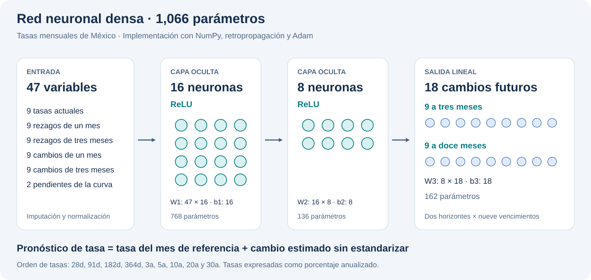
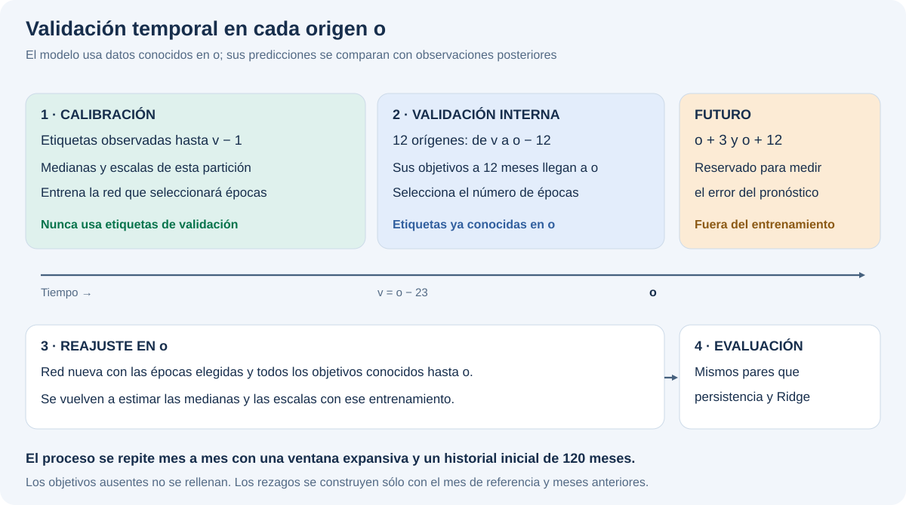

---
language:
- es
tags:
- time-series
- forecasting
- neural-network
- numpy
- finance
---

# México: red neuronal para pronosticar tasas

MLP multisalida implementada en NumPy con retropropagación y Adam. Predice nueve tasas anualizadas a horizontes de tres y doce meses a partir de 47 variables mensuales. El modelo estima cambios futuros y los suma a las tasas del mes de referencia.

## Arquitectura

**47 → 16 ReLU → 8 ReLU → 18 salidas lineales**, con **1,066 parámetros entrenables**. Las variables de normalización e imputación se incluyen en el archivo de tensores, junto con los pesos.



Las 47 entradas contienen nueve tasas actuales, nueve rezagos de un mes, nueve rezagos de tres meses, nueve cambios de un mes, nueve cambios de tres meses y dos pendientes. Su orden exacto está en `config.json`, campo `feature_names`.

Orden de vencimientos: 28, 91, 182 y 364 días; 3, 5, 10, 20 y 30 años. Las 18 salidas se organizan primero por horizonte (3, 12) y después por vencimiento. Las unidades son puntos porcentuales anualizados: `7.25` equivale a 7.25%.

## Datos y entrenamiento

- Fuente: CSV mensual del ejercicio de tasas de subasta; el archivo original no se publica en este repositorio de modelos.
- Periodo disponible: octubre de 2006 a septiembre de 2026, 240 meses y 1,936 tasas observadas. Hay 224 celdas ausentes en la matriz mensual de nueve vencimientos.
- Último mes de referencia del modelo: septiembre de 2026. El entrenamiento final tiene 227 filas elegibles y utiliza únicamente objetivos conocidos hasta ese mes.
- Entradas ausentes: arrastre desde el pasado con límite de dos meses y, para rezagos restantes, medianas aprendidas con el entrenamiento.
- Objetivos ausentes: excluidos mediante máscara, sin imputación.
- Optimización: MSE sobre objetivos estandarizados, peso igual por salida, Adam, aprendizaje 0.003, L2 0.01, semilla 42.
- Épocas: elegidas con validación cronológica interna; máximo 200 y paciencia 20. El modelo final se ajustó durante 44 épocas.

## Evaluación

Evaluación con ventana expansiva desde un historial inicial de 120 meses. En cada origen, la calibración para elegir épocas termina antes del primer origen de validación. Los objetivos de validación están disponibles en el origen evaluado; después se reajusta una red nueva con todos los objetivos conocidos. Las medianas y escalas se aprenden en su correspondiente partición de entrenamiento.



RMSE en puntos base, menor es mejor. Comparación sobre los mismos pares de origen, objetivo y vencimiento:

| Horizonte | MLP | Persistencia | Ridge con nueve tasas | Pares / orígenes |
| --- | ---: | ---: | ---: | ---: |
| 3 meses | 62.21 | 66.07 | 56.50 | 965 / 118 |
| 12 meses | 197.82 | 187.28 | 174.58 | 891 / 109 |

La MLP mejora el RMSE frente a persistencia aproximadamente 5.85% a tres meses y lo empeora aproximadamente 5.63% a doce meses. Ridge tiene menor error en ambos horizontes. `metrics.json` contiene las métricas de todos los comparadores. No se seleccionaron nuevas configuraciones para mejorar estos resultados después de observar el backtest.

## Uso local

Descarga esta carpeta, instala `requirements.txt` y ejecuta:

```bash
python inference_example.py
```

O bien usa la clase de inferencia incluida en `model.py`:

```python
import json
from pathlib import Path
from model import MexicanYieldForecaster

folder = Path(".")
sample = json.loads((folder / "sample_input.json").read_text())
model = MexicanYieldForecaster(folder)
result = model.predict_features(sample["features"], sample["origin_month"])
print(result)
```

`from_pretrained(repo_id, revision=...)` permite descargar los pesos y la configuración desde el Hub utilizando esta misma clase local. Un repositorio privado requiere autenticación. Se recomienda fijar la revisión al hash completo del commit para reproducir una versión.

El ejemplo genera tasas para diciembre de 2026 y septiembre de 2027 a partir de septiembre de 2026. Para otros meses deben construirse nuevas entradas siguiendo el orden de `feature_names`; cambiar la fecha sin cambiar las variables no actualiza el pronóstico.

## Límites

Modelo experimental con pocos datos mensuales y sin intervalos de predicción. Las etiquetas temporales se solapan; los pares evaluados no son independientes. La evaluación trata la observación mensual como disponible al cierre del mes y no reconstruye vintages de publicación. Los valores trasladados desde meses anteriores pueden quedar desactualizados durante periodos sin subastas. No hay restricciones de arbitraje ni garantías de precisión para otros periodos.

El repositorio conserva los pesos y sus metadatos. La inferencia se realiza con el código NumPy incluido.
